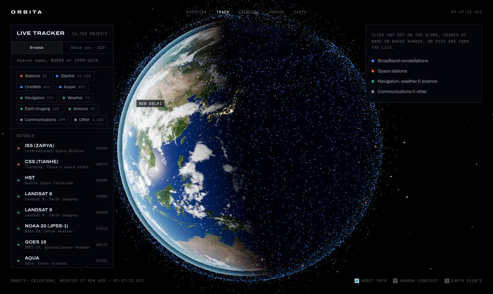
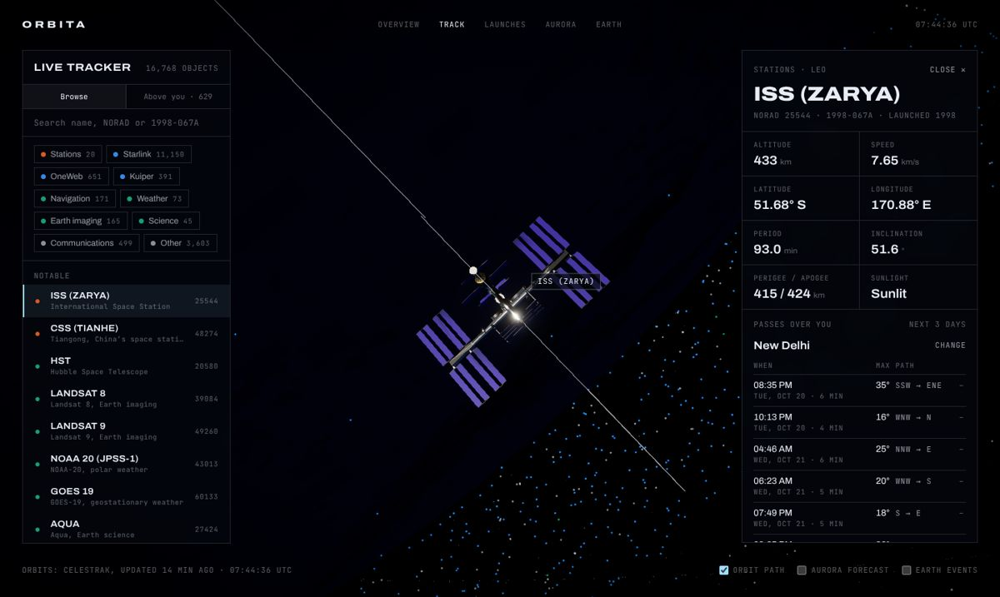
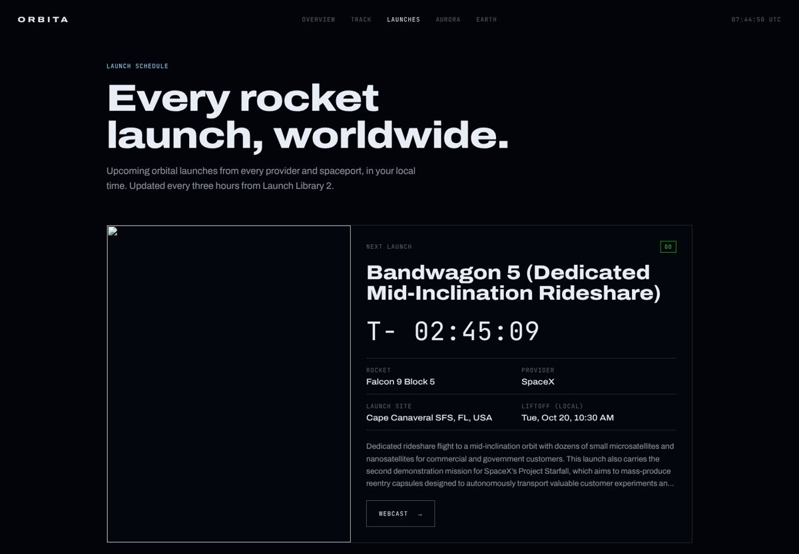
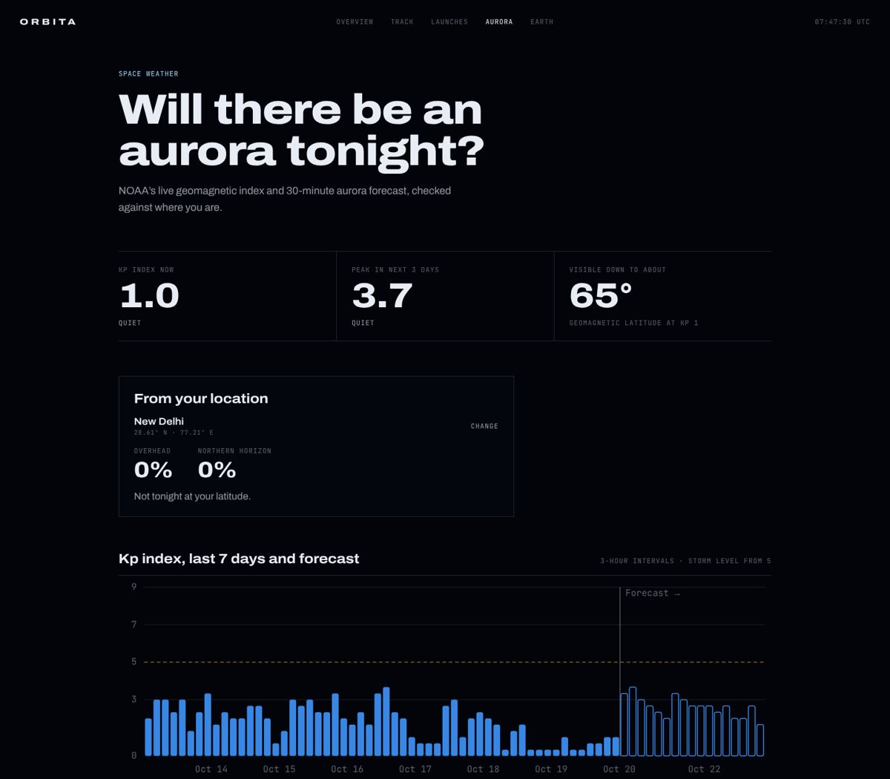

# Orbita

Every satellite, live. A real-time satellite tracker with pass predictions for your location, a worldwide launch schedule, aurora forecasts and live Earth events. Built entirely on open data and runs as a static site.

**Live:** https://siddharth-droid.github.io/WebTest/



| ISS, with passes over you | Launch schedule | Aurora forecast |
| --- | --- | --- |
|  |  |  |

## What you can do

- **Track** (`/track/`): all ~16,000 active satellites in real time on a 3D globe, with the Earth rotated to the actual sidereal time and lit by the actual Sun.
  - Search by name, NORAD number or international designator, and filter by type.
  - Click any satellite for live altitude, speed and position, its orbit and ground track, and whether it's in sunlight.
  - Set your location (GPS or city search) to get **pass predictions**: when it rises, how high it gets, which direction, and whether it will be visible to the naked eye.
  - **Above you** lists every satellite above your horizon right now.
  - Deep links: `/track/?sat=25544` opens the ISS.
- **Launches** (`/launches/`): every upcoming orbital launch worldwide in your local time, with live countdowns, webcast links and a map of launch sites.
- **Aurora** (`/aurora/`): the NOAA Kp index (last 7 days and the 3-day forecast), the live aurora probability map, and the chance of seeing it from your location.
- **Earth** (`/earth/`): active wildfires, storms, volcanoes and icebergs tracked by NASA.
- **Overview** (`/`): a scroll story built around NASA's Landsat 8, ending with every tracked object in orbit.

## Data

All free and open, no API keys. `scripts/fetch-data.mjs` runs in GitHub Actions every 3 hours and writes compact JSON to `public/data/`. If a source is down, the previous file is kept.

| Data | Source |
| --- | --- |
| Orbital elements (GP/OMM) for every active satellite | [CelesTrak](https://celestrak.org) |
| Upcoming and recent launches | [Launch Library 2](https://thespacedevs.com/llapi) by The Space Devs |
| Kp index, Kp forecast, OVATION aurora forecast | [NOAA Space Weather Prediction Center](https://www.swpc.noaa.gov) |
| Natural events | [NASA EONET](https://eonet.gsfc.nasa.gov) |
| City search (in the browser) | [Open-Meteo geocoding](https://open-meteo.com/en/docs/geocoding-api) |

Positions are computed live in the browser with [satellite.js](https://github.com/shashwatak/satellite-js) (SGP4). A Web Worker propagates the whole catalog once a second, sending positions and velocities, and the GPU extrapolates between updates, so 16k points move smoothly with no per-frame CPU work.

## 3D models

The ISS, Hubble and Landsat 8 models come from [NASA 3D Resources](https://github.com/nasa/NASA-3D-Resources). `scripts/prepare-models.sh` runs the full pipeline:

1. **Decode** NASA's Draco compression (`scripts/models/undraco.mjs`).
2. **Bake ambient occlusion in Blender** (`scripts/blender/bake_ao.py`). Cycles ray-traces contact shadows into vertex colours, so crevices between instruments and struts get real depth.
3. **Tune AO strength** (`scripts/models/ao-strength.mjs`) so stacked parts read as shadow, not black.
4. **Optimise** with glTF-Transform: meshopt geometry, WebP textures.

At runtime, `src/lib/materials.ts` upgrades NASA's flat materials by name to PBR: bump-mapped gold foil, clear-coated solar cells, emissive thrusters.

## Run it

```bash
npm install
node scripts/fetch-data.mjs   # pull the open data into public/data/
npm run dev                   # http://localhost:3000
npm run build                 # static export to out/
npm run lint && npm run typecheck
```

## Stack

Next.js 15 (static export), React 19, TypeScript, three.js with React Three Fiber and drei, @react-three/postprocessing, GSAP ScrollTrigger + Lenis (overview story), satellite.js.

## Deploy

`.github/workflows/deploy-pages.yml` fetches the data, builds, and publishes to the `gh-pages` branch on every push to `main` and every 3 hours.

## Credits

- Satellite models: NASA 3D Resources. Earth textures: NASA Blue Marble / Black Marble via the [three.js examples](https://github.com/mrdoob/three.js/tree/dev/examples/textures/planets) (MIT).
- Fonts: Archivo and JetBrains Mono (OFL), self-hosted via Fontsource.
