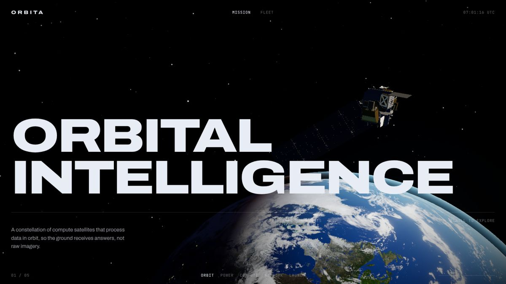
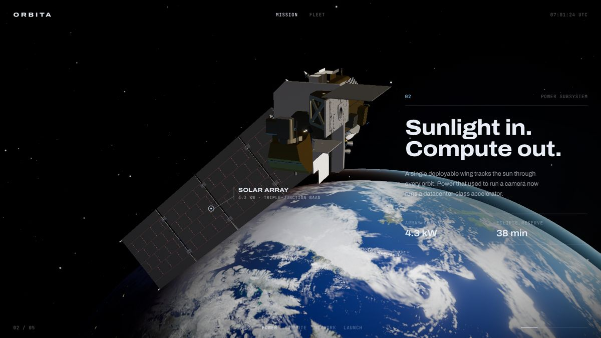
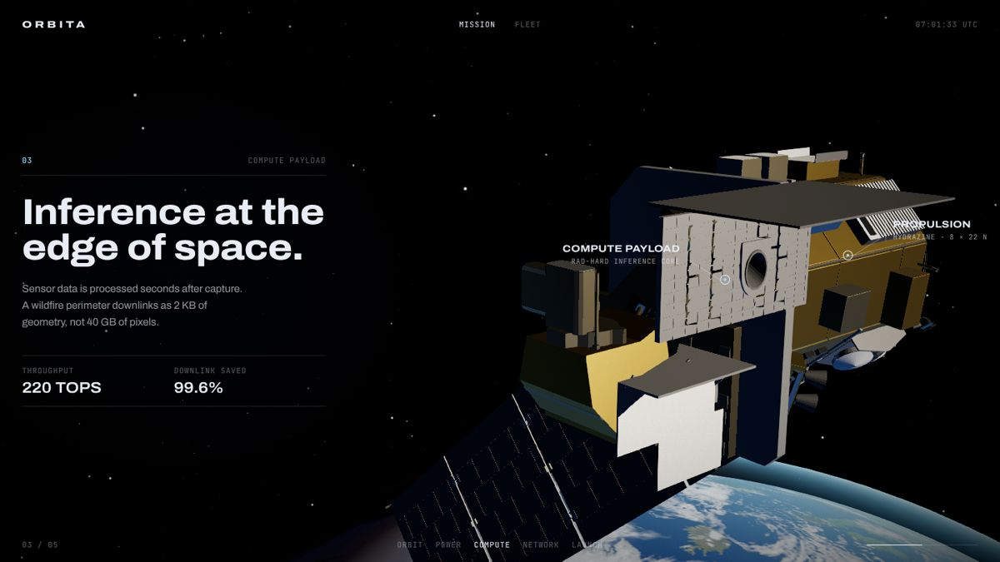
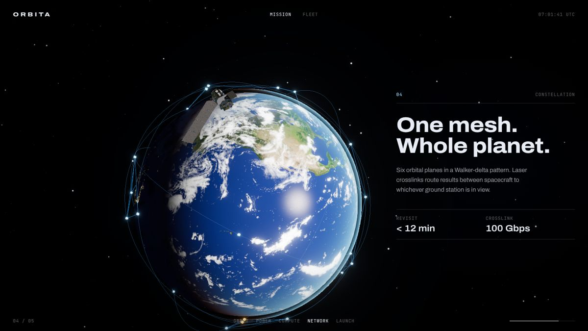
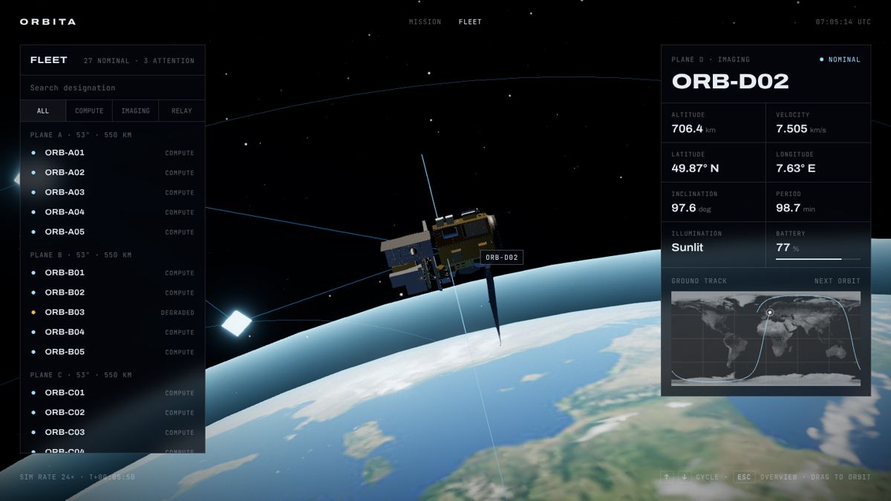

# Orbita

A scroll-driven 3D site and a live fleet console for a (fictional) constellation of compute satellites. Built on the stack most award-winning WebGL sites use.

**Live:** https://siddharth-droid.github.io/WebTest/ · Fleet console: https://siddharth-droid.github.io/WebTest/fleet/



| Power | Compute | Network |
| --- | --- | --- |
|  |  |  |



## Run it

```bash
npm install
npm run dev        # http://localhost:3000
npm run build      # static export to out/
npm run lint && npm run typecheck
```

## Deploy

`.github/workflows/deploy-pages.yml` builds a static export on every push and publishes it to the `gh-pages` branch, which GitHub Pages serves. `NEXT_PUBLIC_BASE_PATH` sets the sub-path (`/WebTest`), and `src/lib/asset.ts` prefixes model and texture URLs with it.

## Routes

- **`/` Mission**: a five-chapter scroll story. The camera flies around a real NASA Landsat 8 model, labelled hotspots appear on its parts, and the shot pulls back to reveal the constellation.
- **`/fleet` Fleet console**: an interactive globe with 30 satellites on a Walker-delta constellation. Select one (click, list, `↑`/`↓`, or deep link `/fleet?sat=D-2`) and a chase camera follows it. Live telemetry comes from real orbital mechanics: period, velocity, sub-satellite point, an eclipse check, and the next-orbit ground track.

## Stack

| Concern | Library | Why |
| --- | --- | --- |
| App framework | Next.js 15 (App Router), React 19, TypeScript | Routing, code-splitting, static output |
| 3D | three.js via **React Three Fiber** | Scenes as components |
| 3D helpers | **@react-three/drei** | `useGLTF`, `Environment`/`Lightformer`, `Html`, `OrbitControls` |
| Post-processing | **@react-three/postprocessing** | Bloom, ACES tone mapping, vignette, grain |
| Scroll animation | **GSAP + ScrollTrigger** (`@gsap/react`) | One scrubbed master timeline |
| Smooth scroll | **Lenis** (`lenis/react`) | Inertial scrolling, driven by GSAP's ticker |

## How the scroll animation works

Scroll never touches React state. `src/lib/story.ts` holds a plain object of numbers (camera position, look-at target, satellite rotation, label opacity). A single GSAP timeline, scrubbed by ScrollTrigger, tweens those numbers, and `useFrame` in the R3F scene copies them onto the camera and model every frame. Each chapter's keyframe lives in `CHAPTERS`, so re-choreographing a shot means editing data, not code.

## How the 3D gets its look

1. **Real model, not primitives.** The spacecraft is NASA's Landsat 8 glTF, compressed with meshopt (`scripts/optimize-model.sh`): 780 KB to about 730 KB of geometry, decoded in the browser by a small WASM decoder.
2. **Re-materialing.** NASA ships every part as flat plastic (metalness 0, roughness 0.81). `src/lib/materials.ts` keeps each part's colour but swaps in physically based materials by name: bump-mapped gold foil, clear-coated solar cells, and emissive thruster throats that bloom.
3. **Lighting.** One hard sun, blue earthshine from below, and a small environment built from `Lightformer` panels, so metals have something to reflect without a photographic HDRI putting trees in the reflections.
4. **Custom Earth shader.** NASA Blue Marble day and Black Marble night textures. City lights appear only past the terminator, clouds drift independently, sun glint appears only on water (from the roughness channel), and the atmosphere scatters blue by day and orange at twilight.
5. **Post.** Bloom catches only pixels brighter than white, then ACES tone mapping, a vignette and faint grain.

## Assets and credits

- Landsat 8 model: [NASA 3D Resources](https://github.com/nasa/NASA-3D-Resources). NASA media is generally not subject to copyright; see NASA's media usage guidelines.
- Earth textures: NASA Blue Marble / Black Marble, via the [three.js examples](https://github.com/mrdoob/three.js/tree/dev/examples/textures/planets) (MIT).
- Fonts: Archivo (variable width axis) and JetBrains Mono, both OFL, self-hosted via Fontsource.

Spacecraft names, specs and telemetry values in the copy are illustrative.
